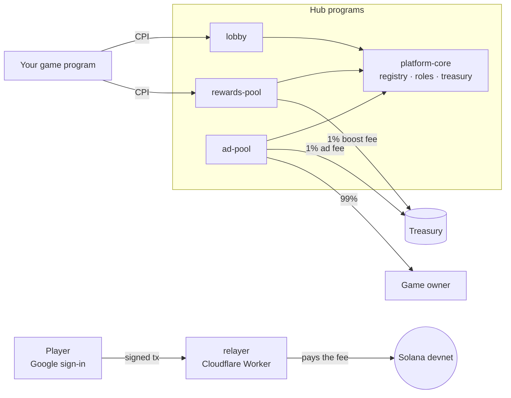

# Onchain Gaming Hub

**Build an on-chain game. Get the rest for free.**

Lobby, rewards, ads, gasless wallets and AI agent players — open source, on Solana, running on Cloudflare.

Every on-chain game rebuilds the same plumbing: rooms and matchmaking, prize pools, a way to earn from the game, and a wallet onboarding that loses players before their first move. Onchain Gaming Hub is that plumbing as a set of shared Solana programs. A game registers once, calls the hub by CPI, and players sign in with Google — the hub pays their fees.

- 🌐 Pitch page: https://hub-web-b7m.pages.dev
- 🎬 Demo video: _coming with the submission_
- 🧭 Status: **devnet only**

## What's in this repo

This repo is the map. Each component lives in its own repository, linked here as a git submodule:

```bash
git clone --recurse-submodules https://github.com/onchain-gaming-hub/onchain-gaming-hub.git
```

| Component | What it does | Program (devnet) |
|---|---|---|
| [**platform-core**](https://github.com/onchain-gaming-hub/platform-core) | Game registry, roles (RBAC), platform fees and treasury, boost-token allowlist, default ads. Every other program relies on it. | [`AJnPSYsn7J2muHfKztRtpZz5kBP94dWkNZLr9aMhu18G`](https://explorer.solana.com/address/AJnPSYsn7J2muHfKztRtpZz5kBP94dWkNZLr9aMhu18G?cluster=devnet) |
| [**lobby**](https://github.com/onchain-gaming-hub/lobby) | Rooms, matchmaking, ready checks and rematch. The lobby freezes the roster, then the game takes over by CPI. | [`5zdBSvep3yV6v1SVD67uw9N5Wb3eT9Hp9D3eg4YSRqRu`](https://explorer.solana.com/address/5zdBSvep3yV6v1SVD67uw9N5Wb3eT9Hp9D3eg4YSRqRu?cluster=devnet) |
| [**rewards-pool**](https://github.com/onchain-gaming-hub/rewards-pool) | A prize pool per match. Anyone can **Boost** it (SOL, tokens, NFTs) with a message; `settle` → `claim`, no deadline. | [`HgApfwjAg1L2FJL3fX7A4WX5yfhrVV8k9Ahii5Pn8HVW`](https://explorer.solana.com/address/HgApfwjAg1L2FJL3fX7A4WX5yfhrVV8k9Ahii5Pn8HVW?cluster=devnet) |
| [**ad-pool**](https://github.com/onchain-gaming-hub/ad-pool) | Per-game ad slots auctioned in SOL each epoch. Creatives pass AI moderation before the verdict is written on chain; 99% of the winning bid goes to the game owner. | [`6T2vwUm5EPBAUQaZNcPwEkgK4rHc9AjoET6DaTq3LEqk`](https://explorer.solana.com/address/6T2vwUm5EPBAUQaZNcPwEkgK4rHc9AjoET6DaTq3LEqk?cluster=devnet) |
| [**relayer**](https://github.com/onchain-gaming-hub/relayer) | Gasless relayer — Cloudflare Worker (Rust/Wasm, Durable Objects, D1). Players sign in with Web3Auth; the project's fee payer covers the fees, only for registered program instructions. | Fee payer [`hp1nnTcTLqrBczEGujPFhvtXzL2HJRxnBumeU216xyr`](https://explorer.solana.com/address/hp1nnTcTLqrBczEGujPFhvtXzL2HJRxnBumeU216xyr?cluster=devnet) |

The demo match in the video runs on a minimal test game program, [`9QfKXj2jLzTy73zmusjduz1ymvomjNindC11xzUkxcD7`](https://explorer.solana.com/address/9QfKXj2jLzTy73zmusjduz1ymvomjNindC11xzUkxcD7?cluster=devnet), that drives lobby → prize pool → claim end to end.

## How it fits together



1. **Register** the game in platform-core. The game signs every CPI with its PDA `[b"game_authority"]`.
2. **Gather** players in a lobby room; the ready check freezes the roster.
3. **Open a prize pool** for the match. Spectators Boost it; boosts go to rank 1.
4. **Settle** the result; winners **claim** their prize.
5. **Earn** from ad slots: advertisers bid in SOL, the game owner gets 99%.

Players never need an extension, a seed phrase or SOL to play — the relayer pays.

## Start building

Each repo has an integration guide (`SKILL.md`, or the README for lobby) — it lists what the program does, its devnet addresses and the order to integrate a game. Start with [platform-core/SKILL.md](https://github.com/onchain-gaming-hub/platform-core/blob/main/SKILL.md).

## Team

Built by **Bored Town** — [Discord](https://discord.gg/mVhZHf5uBu) · [X](https://x.com/BoredTownNFT) · [bored.town](https://www.bored.town/)
